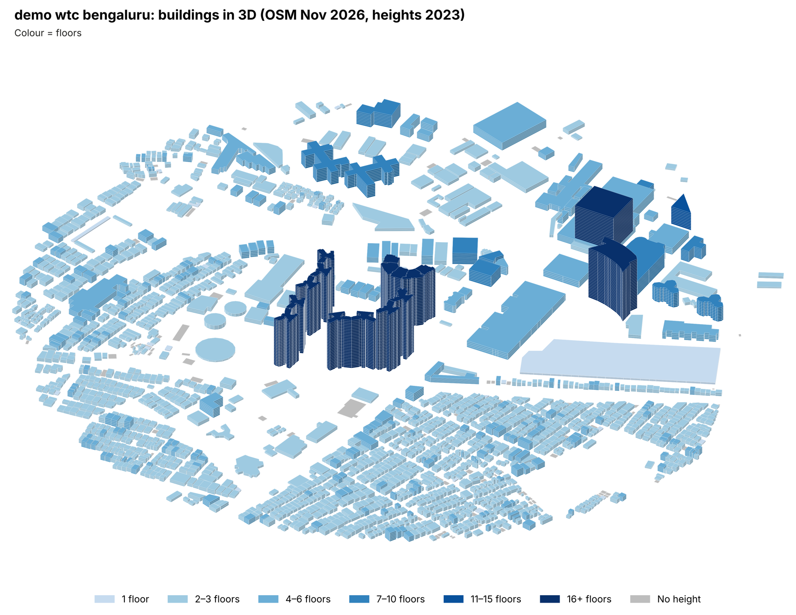
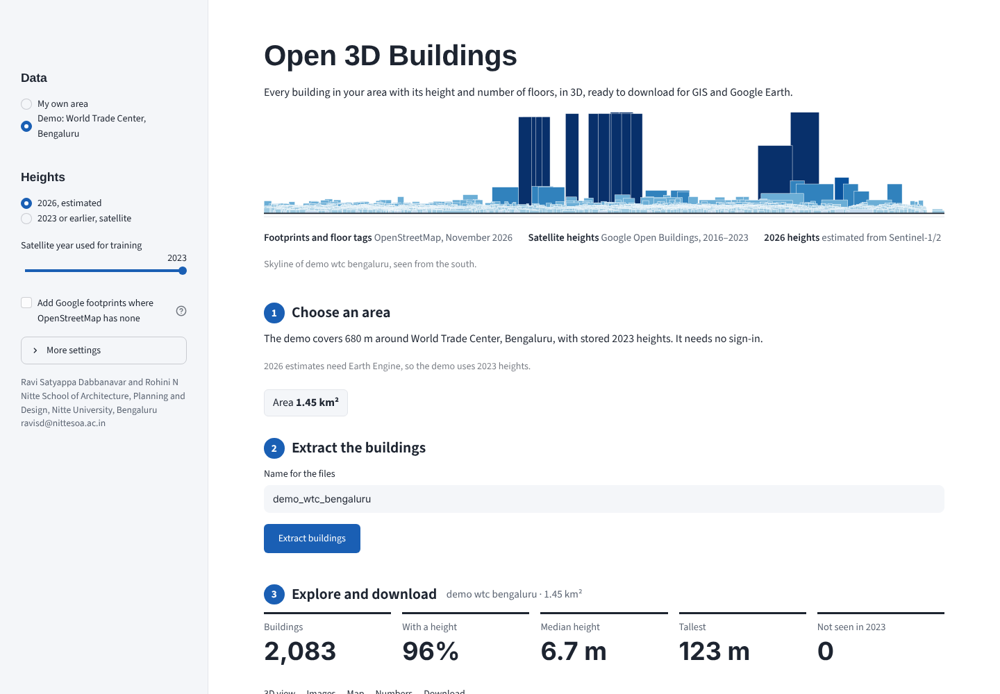

# Open 3D Buildings



**Best-available 3D buildings for any area.** Draw or upload an area and get every building with its height and number of floors, view it in 3D, and download **shapefile, GeoPackage, GeoJSON, CSV, Google Earth 3D (KML)** and **3D images**.

| | Source | Date |
|---|---|---|
| Footprints, names, OSM `height` and `building:levels` tags | OpenStreetMap (downloaded live) | **today** |
| Satellite heights and building presence | Google Open Buildings 2.5D Temporal | 2016–2023 |
| **Current-year (e.g. 2026) heights** | **Modelled** from Sentinel-2 and Sentinel-1 images of that year (see below) | **this year** |
| Extra footprints where OSM has none (optional) | Google Open Buildings v3 | imagery up to 2023 |

## 2026 heights: how they are estimated

No published dataset has building heights after 2023, so the app makes its own estimate in your Earth Engine project:

1. **Train (2023).** Sentinel-2 median composite (cloud-masked with Cloud Score+; bands B2–B12, NDVI, NDBI, MNDWI), Sentinel-1 median VV/VH, and 50 m texture (mean and standard deviation) are stacked on a 10 m grid. Two random forests learn Google's 2023 building height and building presence from up to 8,000 pixels in and around the area (70% train, 30% test).
2. **Predict (2023 and 2026).** The same models are applied to 2023 and to 2026 images, so change is measured with one model on both dates.
3. **Per building.** Existing buildings keep Google's 2023 height plus the modelled change, applied only if it is at least 3 m. New buildings (not seen in 2023) get the modelled 2026 height. Each building is labelled `new`, `taller`, `lower` or `stable`.
4. **Accuracy.** Every run reports the held-out height MAE, RMSE and R², and building-presence accuracy, in the app and in `<name>_summary.json`.

These are **estimates**. Sentinel pixels are 10 m, so they detect new buildings and added floors better than they measure single heights, and tall towers are underestimated. OSM tags always take priority, so adding `building:levels` in OpenStreetMap improves the result. Untick the option (or use `--no-estimate`) to use 2016–2023 satellite heights only.

## How each building gets its height and floors

| Priority | Height (m) | Floors |
|---|---|---|
| 1 | OSM `height` tag | OSM `building:levels` tag |
| 2 | OSM `building:levels` × storey height (3.3 m, plus 0.7 m for a taller ground floor) | OSM `height` tag → floors |
| 3 | 2026 estimate (if chosen), otherwise satellite median height over the footprint | Floor model applied to that height |

**Floor model.** When an area has at least 100 buildings with both an OSM floor tag and a satellite height, a robust (Huber) line *floors = a + b × height* is fitted to them after removing obvious tag errors. Otherwise the Bengaluru calibration is used: *floors = 0.67 + 0.301 × height* (fitted on 11,216 tagged buildings; 76% of held-out buildings within ±1 floor).

**Quality flags** (`flags` column): `not_seen_sat` (satellite presence < 0.3 in the height year), `no_sat_height`, `tag_vs_sat` (OSM floors and satellite disagree by more than max(3, 40%)), `sat_capped_100m` (satellite heights stop at 100 m; tall towers are underestimated).

## Use it



### On the website (no installation)
Open the app link, choose **Demo** to try it, or **My own area** → upload your Earth Engine service-account key ([how to get one](docs/earth_engine.md)) → draw a rectangle or upload a KML → **Extract 3D buildings** → **Downloads**.

### On your computer
```bash
git clone https://github.com/ravi-rayv/open-3d-buildings.git
cd open-3d-buildings
pip install -e ".[app]"
streamlit run app/streamlit_app.py          # opens the app in your browser
```
or from the command line:
```bash
bldg3d demo                                                     # built-in Bengaluru demo, no sign-in
bldg3d run --aoi my_area.kml --project ee-yourname              # your area, with 2026 estimate
bldg3d run --aoi my_area.kml --project ee-yourname --year 2019 --google-footprints
```

## Outputs

| File | Contents |
|---|---|
| `<name>.gpkg`, `<name>.geojson` | Building polygons with all attributes |
| `<name>_shapefile.zip` | Shapefile (field names shortened to 10 characters; field list included) |
| `<name>_3d.kml` | Google Earth: buildings extruded to their height, coloured by floors |
| `<name>.csv` | Attribute table with centroid coordinates |
| `<name>_3d.png / .svg` | Oblique 3D image coloured by floors (300 dpi PNG and vector SVG) |
| `<name>_3d_by_source.png` | Same view coloured by height source |
| `<name>_3d_change.png` | Same view coloured by modelled change 2023 → 2026 |
| `<name>_3d.html` | Interactive 3D page (opens in any browser) |
| `<name>_summary.json` | Settings, counts, floor model and field descriptions |

Main fields: `height_m`, `height_src` (osm_height / osm_levels / estimate / satellite / none), `h_target_est` (2026 estimate), `est_change_m`, `change`, `floors`, `floors_src`, `floor_band`, `building_levels` (OSM), `height` (OSM), `sat_h_median`, `sat_h_p90`, `sat_presence`, `floors_sat`, `possibly_new`, `flags`, `footprint_m2`, `floor_area_m2`.

## Limits
- Satellite heights have a mean absolute error of about 1.5 m, struggle to separate one- and two-storey buildings, and stop at 100 m.
- OSM coverage varies; tick *Add Google footprints* to fill gaps.
- On the free website, keep areas to about 20 km²; run larger areas locally.

## Deploy your own copy
Streamlit Community Cloud → **Create app** → this repository, branch `main`, file `app/streamlit_app.py`, Python 3.11. Or `docker build -t bldg3d . && docker run -p 8501:8501 bldg3d`.

## Authors
**Ravi Satyappa Dabbanavar** and **Rohini N**, Nitte School of Architecture, Planning and Design, Nitte University, Bengaluru, India · ravisd@nittesoa.ac.in

## Data licences and citation
Footprints © OpenStreetMap contributors (ODbL). Heights and optional footprints: Google Open Buildings 2.5D Temporal and v3 (CC BY 4.0). Code: MIT. Please cite this repository ([CITATION.cff](CITATION.cff)) and the data sources.

## Large areas (city or district scale)

Big study areas are no longer sent as one request. The tool now:

1. **Cuts the area into tiles** (default 2 × 2 km, used for areas over 10 km²) and downloads OpenStreetMap tile by tile. A tile that still fails (Overpass timeout or memory error) is split into four smaller tiles and retried.
2. **Sends buildings to Earth Engine in spatially compact batches** (neighbouring buildings together), so each request only touches a small part of the area. A batch that times out or runs out of memory is split in half and retried.
3. **Saves every finished tile and batch** in a cache folder (`cache_dir`, default: a folder in the system temp directory). If a run stops, start it again with the same area and it continues from where it stopped. Only the missing pieces are downloaded.
4. **Compiles the pieces**, removes buildings that appear in two neighbouring tiles, and then runs the analysis on the merged data.

Settings (portal: *Large areas* panel; command line: `bldg3d run ... --set tile_km=1 --set cache_dir=D:/bldg3d_cache`):

| setting | default | meaning |
|---|---|---|
| `tile_above_km2` | 10 | areas larger than this are downloaded in tiles |
| `tile_km` | 2.0 | tile edge in km (use 1 km for very dense city centres) |
| `chunk_size` | 2000 | buildings per Earth Engine request (lower to 500–1000 if batches keep failing) |
| `workers` | 6 | parallel Earth Engine requests |
| `max_split_depth` | 2 | how many times a failing tile or batch may be split |
| `allow_missing_tiles` | False | if True, continue even if some tiles still fail (results are then incomplete) |
| `cache_dir` | "" | folder for downloaded pieces; set it to a permanent folder for very large runs |
| `cache_days` | 7 | pieces older than this are downloaded again |
| `max_area_km2` | 5000 | largest area accepted |
